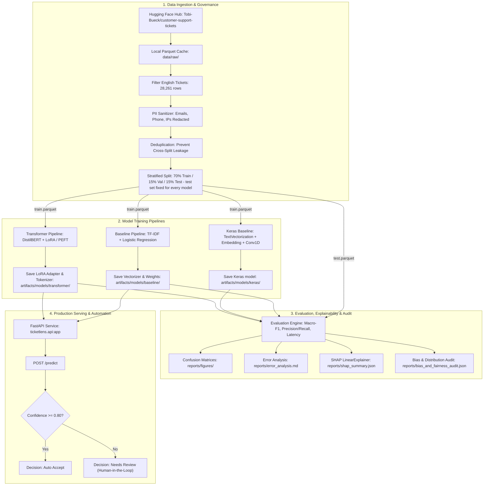

# TicketLens: IT Support Ticket Classification & Routing System

[](https://www.python.org/)
[](LICENSE)
[](https://creativecommons.org/licenses/by-nc/4.0/)
[](https://fastapi.tiangolo.com/)
[](https://huggingface.co/distilbert/distilbert-base-uncased)
[](https://keras.io/)
[](https://github.com/Charanloyal/ticketlens/actions/workflows/benchmark.yml)
[](https://github.com/Charanloyal/ticketlens/actions/workflows/ci.yml)
[](https://docs.pytest.org/)

**TicketLens** is an end-to-end IT service desk ticket classification and triage engine with an ultra-sleek, dark-mode glassmorphic web dashboard. It classifies IT issues into standard ITIL categories (**Incident**, **Request**, **Problem**, **Change**) by fine-tuning a pre-trained **DistilBERT** with **LoRA (Hugging Face Transformers + PEFT, PyTorch)** and benchmarking it on **macro-F1** against a **TF-IDF + Logistic Regression** baseline and a **Keras (TensorFlow) CNN** baseline, all scored on the identical held-out test set.

The platform includes precision/recall **error analysis**, **SHAP** interpretability, a **bias check** (class balance, performance parity by ticket length, PII audit), PII scrubbing, latency benchmarking, and a **FastAPI** service with confidence-gated routing, packaged in **Docker** (a DistilBERT + LoRA image and a lightweight TF-IDF image that runs on Render's free plan).

---

## Architecture & Data Flow



---

## Dataset Source, Schema & License

- **Source:** [`Tobi-Bueck/customer-support-tickets`](https://huggingface.co/datasets/Tobi-Bueck/customer-support-tickets) (mirrored from the customer IT support ticket dataset).
- **License:** [Creative Commons Attribution Non-Commercial 4.0 International (`CC-BY-NC-4.0`)](https://creativecommons.org/licenses/by-nc/4.0/).
- **DOI:** `10.57967/hf/6184`
- **Language:** English (`language == 'en'`).
- **Target Categories (ITIL Standards):**
  1. `Incident`: Unplanned service interruptions (e.g., VPN disconnections, hardware crashes, screen flicker).
  2. `Request`: Formal service and access requests (e.g., credentials, hardware upgrades, secondary monitors).
  3. `Problem`: Root-cause investigations of recurring outages (e.g., memory leaks, database connection pool exhaustion).
  4. `Change`: Scheduled configuration and infrastructure adjustments (e.g., firewall rule modification, node pool rolling upgrade).
- **Input Features:** `subject` + `body` combined and sanitized into a single context stream (`text`).

---

## Project Structure

```
TicketLens/
├── configs/
│   └── config.yaml               # Centralized hyperparameters, dataset, and threshold configs
├── data/
│   ├── fixtures/
│   │   ├── synthetic_tickets.json # Offline test fixture for reproducible unit tests
│   │   ├── handwritten_eval.json  # 48 hand-written tickets (development set for ITIL cues)
│   │   └── handwritten_holdout.json # 24 hand-written tickets (holdout, never used for tuning)
│   ├── raw/                      # Cached raw parquet dataset
│   └── processed/                # Preprocessed train, val, test parquet splits & label mapping
├── artifacts/
│   └── models/
│       ├── baseline/             # TF-IDF vectorizer + Logistic Regression joblib artifacts
│       └── transformer/          # DistilBERT LoRA adapter weights, tokenizer, & labels
├── reports/
│   ├── figures/
│   │   ├── confusion_matrix_baseline.png
│   │   ├── confusion_matrix_transformer.png
│   │   └── model_comparison_f1.png
│   ├── metrics_baseline.json     # Baseline validation metrics
│   ├── metrics_transformer.json  # Transformer validation metrics
│   ├── metrics_test_baseline.json
│   ├── metrics_test_transformer.json
│   ├── model_comparison.json     # Held-out test set comparison metrics
│   ├── benchmark_latency.json    # P50, P95, P99 latency & throughput benchmarks
│   ├── top_features_per_class.json # Top positive and negative n-gram coefficients
│   ├── shap_summary.json         # SHAP mean absolute attributions
│   └── explainability_and_bias_report.md # Full audit of dataset balance, PII, and bias
├── notebooks/
│   └── 01_exploratory_data_analysis.ipynb # Interactive EDA and ticket distribution plots
├── src/
│   └── ticketlens/
│       ├── __init__.py
│       ├── config.py             # Path resolution and CUDA/CPU auto-detection
│       ├── data.py               # Data ingestion, schema validation, PII scrubbing, & splitting
│       ├── train_baseline.py     # TF-IDF + Logistic Regression training
│       ├── build.py              # Production build (download → corpus → train, one process each)
│       ├── train_transformer.py  # DistilBERT sequence classification with PEFT / LoRA
│       ├── train_keras.py        # Keras (TensorFlow) CNN baseline
│       ├── evaluate.py           # Benchmark on the shared test set + precision/recall error analysis
│       ├── explain.py            # SHAP attribution and dataset bias audit
│       ├── predict.py            # Reproducible CLI and inference engine
│       ├── itil_rules.py         # ITIL keyword cues that correct predictions on short tickets
│       ├── language.py           # Dependency-free non-English input detection
│       └── api.py                # FastAPI inference service (/health, /metadata, /predict)
├── tests/
│   ├── conftest.py               # Pytest fixtures and TestClient configuration
│   ├── test_data.py              # Data cleaning, PII redaction, schema, and leakage tests
│   ├── test_models.py            # Baseline fit, tokenization, and metric tests
│   ├── test_api.py               # API health, metadata, auth, validation, and prediction tests
│   ├── test_quality.py           # ITIL cues, language detection, config overrides, augmentation
│   └── test_benchmark.py         # Fixed test split, Keras baseline, evaluation & error analysis
├── scripts/
│   ├── run_pipeline.py           # End-to-end pipeline runner
│   ├── benchmark_latency.py      # Latency & throughput benchmarking script
│   ├── evaluate_handwritten.py   # Accuracy on hand-written, real-world-style tickets
│   └── run.ps1                   # Windows PowerShell automation helper
├── Dockerfile                    # Lightweight TF-IDF serving image (same as Render)
├── Dockerfile.transformer        # DistilBERT + LoRA serving image (FastAPI)
├── .dockerignore                 # Container build exclusion rules
├── .gitignore                    # Git tracking ignore rules
├── requirements.txt              # Full dependency set (training, transformer, explainability)
├── requirements-render.txt       # Lightweight serving dependencies for Render (no torch)
├── render.yaml                   # Render Blueprint (free plan)
├── .github/workflows/ci.yml      # CI: replays the Render build, tests, smoke test, both Docker images
├── .github/workflows/benchmark.yml # Trains TF-IDF, Keras & DistilBERT, evaluates, publishes the "models" release
├── LICENSE                       # Apache License 2.0
├── pyproject.toml                # Build configuration and pytest options
├── Makefile                      # Cross-platform development targets
└── README.md                     # Comprehensive project documentation
```

---

## Installation & Setup

### Windows PowerShell

```powershell
# 1. Clone or navigate to the project directory
cd C:\Users\Windows-E\.gemini\antigravity-ide\scratch\TicketLens

# 2. Create isolated virtual environment
python -m venv .venv

# 3. Activate virtual environment
.\.venv\Scripts\Activate.ps1

# 4. Install dependencies and local package in editable mode
pip install --upgrade pip
pip install -r requirements.txt
pip install -e .
```

### Linux / macOS

```bash
cd TicketLens
python3 -m venv .venv
source .venv/bin/activate
pip install --upgrade pip
pip install -r requirements.txt
pip install -e .
```

---

## Quick-Start Commands

| Command | Purpose |
| :--- | :--- |
| `pytest tests/ -v` | Run the complete automated test suite (63 tests) |
| `python -m ticketlens.train_baseline --mode quick` | Train TF-IDF baseline model (quick verification run) |
| `python -m ticketlens.build` | Production build exactly as on Render: download dataset, prepare corpus, train serving model (each step in its own process) |
| `python -m ticketlens.train_baseline --mode all` | Train the serving TF-IDF model on the full dataset in a single process (local development) |
| `python scripts/evaluate_handwritten.py` | Score the serving model on hand-written tickets (with/without ITIL cues) |
| `python -m ticketlens.train_baseline --mode full --model-name tfidf_benchmark --no-augment` | TF-IDF baseline on the benchmark subset (7,000 tickets) |
| `python -m ticketlens.train_keras --mode full` | Keras (TensorFlow) CNN baseline on the same subset |
| `python -m ticketlens.train_transformer --mode full` | Fine-tune DistilBERT with LoRA on the same subset (~20-35 min on CPU) |
| `python -m ticketlens.evaluate` | Benchmark every trained model on the identical test set + error analysis |
| `make benchmark` | All of the above plus SHAP / bias analysis |
| `python -m ticketlens.explain` | Generate SHAP attributions and bias audit report |
| `python scripts/benchmark_latency.py` | Benchmark inference latency (P50, P95, P99) & throughput |
| `python -m ticketlens.predict "VPN dropped with TLS error"` | Classify a sample ticket from terminal CLI |
| `uvicorn ticketlens.api:app --reload --port 8000` | Start the FastAPI production server |

Alternatively, use the convenience helper scripts:
- **Windows:** `.\scripts\run.ps1 test`, `.\scripts\run.ps1 train-quick`, `.\scripts\run.ps1 api`
- **Linux/macOS:** `make test`, `make train-quick`, `make api`

---

## Benchmark Results (Macro-F1, identical held-out test set)

Produced by the [Benchmark workflow](.github/workflows/benchmark.yml) (GitHub Actions, CPU, Python 3.11) and
published with the trained models as the [`models` release](https://github.com/Charanloyal/ticketlens/releases/tag/models).
Full reports: [`reports/evaluation_summary.md`](reports/evaluation_summary.md) and
[`reports/error_analysis.md`](reports/error_analysis.md).

**Protocol.** The 23,747 cleaned, deduplicated English tickets are split once (70/15/15, stratified, seed 42).
Every model is scored on the **same 3,563 test tickets**. The three architectures are trained on the **same
7,000-ticket training subset** (CPU budget for the transformer) with a 1,500-ticket validation set for model
selection; the served TF-IDF model uses the whole training split.

| Model | Framework | Train tickets | Accuracy | **Macro-F1** | Weighted-F1 | Hand-written holdout (24) | P50 latency |
| :--- | :--- | ---: | :---: | :---: | :---: | :---: | ---: |
| TF-IDF + Logistic Regression | scikit-learn | 7,000 | 0.8266 | **0.8352** | 0.8270 | 33.3% | 0.8 ms |
| Keras CNN (TextVectorization + Embedding + Conv1D) | TensorFlow / Keras | 7,000 | 0.7884 | **0.8095** | 0.7932 | 45.8% | 7.7 ms |
| DistilBERT + LoRA (r=8, q/v, 1.09% trainable) | PyTorch + HF Transformers + PEFT | 7,000 | 0.7920 | **0.7790** | 0.7777 | **62.5%** | 57 ms |
| Served TF-IDF (model only) | scikit-learn | 16,622 + aug. | 0.8712 | **0.8782** | 0.8717 | 37.5% | 0.8 ms |
| Served TF-IDF + ITIL cues (production on Render) | scikit-learn | 16,622 + aug. | 0.8549 | **0.8635** | 0.8565 | **79.2%** | 0.8 ms |

Latency is single-ticket (batch size 1) on a shared 4-vCPU GitHub runner, so treat it as relative.

**Per-class precision / recall** (P / R):

| Model | Change | Incident | Problem | Request |
| :--- | :---: | :---: | :---: | :---: |
| TF-IDF + LR | 0.95 / 0.95 | 0.80 / 0.78 | 0.60 / 0.62 | 0.99 / 0.99 |
| Keras CNN | 0.95 / 0.93 | 0.81 / 0.65 | 0.51 / 0.71 | 0.98 / 0.99 |
| DistilBERT + LoRA | 0.94 / 0.96 | 0.71 / 0.85 | 0.54 / 0.34 | 0.98 / 0.98 |
| Served TF-IDF + ITIL cues | 0.95 / 0.95 | 0.86 / 0.79 | 0.65 / 0.74 | 0.98 / 0.99 |

### Error analysis (precision / recall)

- **Incident ↔ Problem accounts for 92-95% of all errors** for every model (e.g. TF-IDF: 303 Incident→Problem and
  279 Problem→Incident of 618 errors). Both describe something broken; ITIL separates them by recurrence /
  root-cause intent, which the synthetic labels apply inconsistently. Request and Change are near-perfect.
- **Confidence gate:** at the 0.80 threshold, auto-accepted tickets are far more precise than overall accuracy
  (TF-IDF 96.0% precision at 53% coverage; DistilBERT 94.4% at 55%; served model 96.4% at 65%), so the gate
  routes the ambiguous Incident/Problem tickets to human review. See `reports/figures/precision_coverage.png`.
- **Length parity (bias check):** Macro-F1 is stable for tickets under 100 words (0.85 / 0.84 for TF-IDF,
  0.78 / 0.78 for DistilBERT) and drops on the rarer 100-199-word tickets for the bag-of-words model (0.76),
  while DistilBERT stays flat (0.77), see `error_analysis.md`.
- **Real-world generalisation:** on the 24-ticket hand-written holdout (`data/fixtures/handwritten_holdout.json`,
  never used for tuning), **DistilBERT + LoRA reaches 62.5% vs. 45.8% (Keras) and 33.3% (TF-IDF)** trained on the same
  data: the transformer transfers best beyond the long-form synthetic style, while the bag-of-words models win
  on the in-distribution test split. The production service closes that gap with the ITIL cue layer (79.2%).
  The holdout is small, so treat these as indicative.

### Training details

| | TF-IDF + LR | Keras CNN | DistilBERT + LoRA |
| :--- | :--- | :--- | :--- |
| Features / backbone | word 1-2-grams, 80k max | 30k vocab, 256 tokens, 128-d embeddings | `distilbert-base-uncased`, 128 tokens |
| Trainable parameters | linear | 3.9 M | 0.74 M of 67.7 M (1.09%) |
| Optimisation | L-BFGS, C=4, balanced | Adam 1e-3, balanced class weights, early stopping (8 epochs) | AdamW 3e-4, linear warm-up, 3 epochs, best epoch kept (2) |
| Validation Macro-F1 | 0.8103 | 0.7894 | 0.7922 |
| Training time (4 vCPU) | 2 s | 73 s | 59 min |

*Ablation:* LoRA on all six DistilBERT linear layers (r=16, 2.79% trainable) with a class-balanced loss
overfit after epoch 1 (validation Macro-F1 0.789 → 0.769), so the lighter q/v adapter is used.

### Serving model on Render (free plan)

The Render deployment runs the served TF-IDF model plus the ITIL cue correction from
[`itil_rules.py`](src/ticketlens/itil_rules.py) (the DistilBERT container needs ~430 MB at idle, too close to the 512 MB free-plan limit under load; it is served by
[`Dockerfile.transformer`](Dockerfile.transformer) instead). The cues trade ~1.5 Macro-F1 points on the
synthetic split for a large gain on the hand-written holdout (37.5% → 79.2%). Set `inference.itil_cue_weight: 0`
to disable them. The hand-written sets are small, so treat those numbers as indicative.

---

## FastAPI Inference Service

### 1. Health Endpoint (`GET /health`)
```bash
curl -X GET http://localhost:8000/health
```
```json
{
  "status": "healthy",
  "ready": true,
  "models_loaded": ["baseline", "transformer"]
}
```

### 2. Metadata Endpoint (`GET /metadata`)
```bash
curl -X GET http://localhost:8000/metadata
```
```json
{
  "project_name": "TicketLens",
  "version": "0.1.0",
  "dataset_name": "Tobi-Bueck/customer-support-tickets",
  "target_categories": ["Incident", "Request", "Problem", "Change"],
  "device": "cpu",
  "models_available": ["baseline", "transformer"],
  "default_model": "transformer",
  "confidence_threshold": 0.8,
  "auth_required": false
}
```

### 3. Prediction Endpoint (`POST /predict`)

Responses also include `itil_cues` (ITIL keyword signals that adjusted the probabilities) and
`warnings` (e.g. non-English input). Any warning forces `"decision": "Needs Review"`.

#### Request (Incident Example)
```bash
curl -X POST http://localhost:8000/predict \
  -H "Content-Type: application/json" \
  -d '{"text": "Production Kubernetes worker node memory spiked to 98% and pods were evicted.", "model_type": "baseline"}'
```

#### Response
```json
{
  "predicted_category": "Incident",
  "confidence": 0.6384,
  "decision": "Needs Review",
  "probabilities": {
    "Change": 0.0821,
    "Incident": 0.6384,
    "Problem": 0.1642,
    "Request": 0.1153
  },
  "model_type": "TF-IDF + Logistic Regression",
  "model_version": "0.1.0",
  "confidence_threshold": 0.8,
  "itil_cues": {},
  "warnings": []
}
```

#### Request (Request Example - High Confidence)
```bash
curl -X POST http://localhost:8000/predict \
  -H "Content-Type: application/json" \
  -d '{"text": "Please provide read-only database credentials and analytical query access for our new analyst.", "model_type": "baseline"}'
```

#### Response (Auto Accept)
```json
{
  "predicted_category": "Request",
  "confidence": 0.8912,
  "decision": "Auto Accept",
  "probabilities": {
    "Change": 0.0211,
    "Incident": 0.0345,
    "Problem": 0.0532,
    "Request": 0.8912
  },
  "model_type": "TF-IDF + Logistic Regression",
  "model_version": "0.1.0",
  "confidence_threshold": 0.8,
  "itil_cues": {"Request": ["access request"]},
  "warnings": []
}
```

### 4. Optional API Key Authentication

By default `/predict` is open (public demo). Set the `TICKETLENS_API_KEY` environment variable to
require an `X-API-Key` header; requests without the correct key get `401`. `/health`, `/metadata`
and the dashboard stay public (Render health checks need `/health`), and the dashboard prompts for the
key once and stores it in the browser.

```bash
curl -X POST http://localhost:8000/predict \
  -H "Content-Type: application/json" -H "X-API-Key: $TICKETLENS_API_KEY" \
  -d '{"text": "VPN keeps disconnecting since this morning"}'
```

### 5. Non-English Input

Models are trained on English tickets only. Non-English text (non-Latin scripts, or German, Spanish,
French, Portuguese, Italian and Dutch function words) is still classified but returns a warning and is
always routed to `Needs Review`.

---

## Explainability (SHAP) & Bias Auditing

TicketLens features automated feature attribution and dataset-level auditing generated via `python -m ticketlens.explain`:

### Top Driving N-Grams (TF-IDF Coefficients & SHAP Attributions)

From [`reports/top_features_per_class.json`](reports/top_features_per_class.json) and
[`reports/shap_summary.json`](reports/shap_summary.json) (SHAP `LinearExplainer` on the served model):
- **`Change`:** `update`, `enhance`, `improve`, `revise`, `boost`, `enhancement`.
- **`Incident`:** `problem`, `incident`, `breach`, `issue`, `has`, `issues`.
- **`Problem`:** `problem`, `facing`, `issue`, `issues`, `problem with`, `despite`.
- **`Request`:** `for`, `details`, `strategies`, `integrating`, `guidance`, `information`.

The overlap of `problem` / `issue` between Incident and Problem explains the dominant confusion pair in the
error analysis.

### Bias Check

[`reports/bias_and_fairness_audit.json`](reports/bias_and_fairness_audit.json) and the error analysis cover:
class balance (Incident 39.7%, Request 29.0%, Problem 20.8%, Change 10.5%; imbalance 3.77:1, handled with
class-balanced training), ticket-length profiles per class, performance parity by ticket length, and a PII scan
of the raw text before redaction.

### Responsible AI & Privacy Considerations
1. **PII Sanitization:** Enterprise IT tickets frequently contain customer emails, direct callback numbers, and internal IP addresses. TicketLens implements an upfront regex sanitization pipeline that replaces email strings with `[EMAIL]`, phone numbers with `[PHONE]`, and IP addresses with `[IP]`.
2. **Confidence-Gated Routing:** The routing threshold is set to `0.80`. Any ticket with classification confidence below 80% is marked `"Needs Review"` and flagged for human-in-the-loop triage, mitigating the risk of silent misrouting on high-impact incidents.
3. **Audit Scope:** A balanced class distribution does not guarantee absence of subtle organizational or linguistic bias across diverse technical departments. Periodic retraining and model drift monitoring are recommended.

---

## Docker Deployment

Two images are provided; both download the dataset during `docker build` (internet access to Hugging
Face is required at build time).

### Serving the fine-tuned DistilBERT + LoRA model

[`Dockerfile.transformer`](Dockerfile.transformer) serves the fine-tuned DistilBERT through the same FastAPI
app. It installs CPU-only PyTorch, downloads the LoRA adapter published by the
[Benchmark workflow](.github/workflows/benchmark.yml) (GitHub release `models`), bakes in the DistilBERT
base weights so the container runs offline, and defaults `/predict` to the transformer (~430 MB RAM, measured in CI).

```bash
docker build -f Dockerfile.transformer -t ticketlens:transformer .
docker run -p 8000:8000 --rm ticketlens:transformer
curl -X POST http://localhost:8000/predict -H "Content-Type: application/json" \
  -d '{"text": "VPN is down for the whole office since this morning"}'   # model_type: DistilBERT (PEFT / LoRA)
```

### Lightweight TF-IDF image (same as Render)

[`Dockerfile`](Dockerfile) mirrors the Render setup: lightweight serving stack (no PyTorch) and the
TF-IDF model trained during the build; runs in ~240 MB.

```bash
# 1. Build the Docker container image (downloads the dataset and trains the serving model)
docker build -t ticketlens:latest .

# 2. Run the container on port 8000
docker run -p 8000:8000 --rm ticketlens:latest

# 3. Test container health
curl -f http://localhost:8000/health
```

---

## Deploying to Render Cloud

TicketLens is configured out-of-the-box for seamless, production deployment to **[Render](https://render.com/)**.

### Method 1: 1-Click Infrastructure Blueprint (Recommended)

The repository includes a ready-to-use [`render.yaml`](render.yaml) specification file.

1. Push your repository to GitHub: `https://github.com/Charanloyal/ticketlens`.
2. Log in to [Render Dashboard](https://dashboard.render.com/).
3. Click **New +** → **Blueprint**.
4. Connect your `ticketlens` repository.
5. Render will automatically detect `render.yaml` and configure:
   - **Service Name:** `ticketlens`
   - **Environment:** `Python 3.11+`
   - **Build Command:** `pip install --upgrade pip && pip install -r requirements-render.txt && PYTHONPATH=src python -m ticketlens.build`
   - **Start Command:** `uvicorn main:app --host 0.0.0.0 --port $PORT --proxy-headers --forwarded-allow-ips='*'`
   - **Health Check Path:** `/health`
6. Click **Apply**. Render will deploy the application with live logging.
7. *(Optional)* To protect `/predict`, add `TICKETLENS_API_KEY` under the service's **Environment** tab.

**Deploy safety nets**
- `python -m ticketlens.build` runs dataset download, corpus preparation and training as separate processes,
  so only one step's memory is resident at a time (CI fails if any step exceeds 512 MB).
- The build **fails** (`--require-dataset`) if the Hugging Face dataset can't be downloaded, instead of
  silently training on the 8-ticket test fixture. A failed build leaves the previous deploy live.
- `/health` returns **503** when no model is loaded, so Render never routes traffic to a broken deploy.
- With `TICKETLENS_ENV=production` the app never trains at startup (which would exceed 512 MB).
- The [CI workflow](.github/workflows/ci.yml) replays the exact Render build on Python 3.11, runs the tests,
  boots the server, smoke-tests `/health` and `/predict`, and fails if the server uses more than 400 MB.

**Free plan behaviour:** free web services sleep after ~15 minutes without traffic. The first visit then
takes roughly 30–60 seconds while Render wakes the service; the dashboard shows a "Waking up server…"
status and a hint during that time. Subsequent requests are instant.

> **Why a separate `requirements-render.txt`?** Render's free plan has a 512 MB RAM limit. The full
> `requirements.txt` pulls in PyTorch, Transformers, SHAP and plotting libraries, which alone exceed that
> limit. The Render build installs only the lightweight serving stack and trains the TF-IDF + Logistic
> Regression model during the build (`ticketlens.build` runs download, corpus preparation and training as separate processes to keep
> each step's peak memory low; ~1 minute total), so the server binds `$PORT` within seconds
> and runs in ~240 MB.
> Requests for the `transformer` model automatically fall back to the baseline when no fine-tuned
> transformer artifacts are present.

### Method 2: Manual Web Service Setup

If you configure the Web Service manually via Render UI:

1. In Render Dashboard, click **New +** → **Web Service**.
2. Connect your GitHub repository `https://github.com/Charanloyal/ticketlens`.
3. Fill in the following settings:
   - **Name:** `ticketlens`
   - **Language / Runtime:** `Python`
   - **Region:** Any (e.g. `Oregon (US West)` or `Frankfurt (EU)`)
   - **Branch:** `main`
   - **Build Command:**
     ```bash
     pip install --upgrade pip && pip install -r requirements-render.txt && PYTHONPATH=src python -m ticketlens.build
     ```
   - **Start Command:**
     ```bash
     uvicorn main:app --host 0.0.0.0 --port $PORT --proxy-headers --forwarded-allow-ips='*'
     ```
   - **Plan:** `Free`
4. Add the following **Environment Variables**:
   - `PYTHON_VERSION`: `3.11.9`
   - `TICKETLENS_ENV`: `production`
   - `PYTHONPATH`: `src:.`
   - `TICKETLENS_CONFIDENCE_THRESHOLD`: `0.80`
   - `TICKETLENS_API_KEY`: *(optional)* any secret value to require an `X-API-Key` header on `/predict`
5. Set **Health Check Path** under *Advanced*: `/health`.
6. Click **Create Web Service**. Your live public application URL will be provisioned at `https://ticketlens-xxxx.onrender.com`.

---

## Troubleshooting & FAQ

- **Issue:** `ModuleNotFoundError: No module named 'ticketlens'`
  - **Resolution:** Run `pip install -e .` inside the active virtual environment to install the project package in editable mode.
- **Issue:** Render deploy fails with `Out of memory (used over 512Mi)` / `No open ports detected`
  - **Resolution:** Make sure the service uses `requirements-render.txt` (not `requirements.txt`) and the build command from `render.yaml`. Installing PyTorch/Transformers or training at startup exceeds the free-plan memory limit.
- **Issue:** Render build fails with `Refusing to fall back to the tiny synthetic fixture`
  - **Resolution:** The Hugging Face dataset download failed (network issue or rate limit). The previous deploy stays live; click **Manual Deploy → Deploy latest commit** to retry.
- **Issue:** Render deploy fails its health check / `/health` returns `503`
  - **Resolution:** No model artifacts were found at startup. Check the build log for the `Baseline validation: Macro-F1=...` line; the build command must include the `train_baseline` step.
- **Issue:** The live site takes ~30–60 s to respond to the first request
  - **Resolution:** Expected on Render's free plan (the service sleeps when idle). Upgrade to a paid instance for always-on serving.
- **Issue:** `CUDA not detected / Using CPU`
  - **Resolution:** `TicketLens` automatically detects whether CUDA is available and selects `cuda` when present, gracefully falling back to `cpu` without configuration changes.
- **Issue:** `Hugging Face download timeout or offline environment`
  - **Resolution:** For local development the system falls back to `data/fixtures/synthetic_tickets.json` when the Hugging Face Hub is unreachable. Production builds (`python -m ticketlens.build`) fail instead.

---

## License

This project is licensed under the [Apache License 2.0](LICENSE). The underlying dataset (`Tobi-Bueck/customer-support-tickets`) is licensed under [Creative Commons Attribution Non-Commercial 4.0 (`CC-BY-NC-4.0`)](https://creativecommons.org/licenses/by-nc/4.0/).
