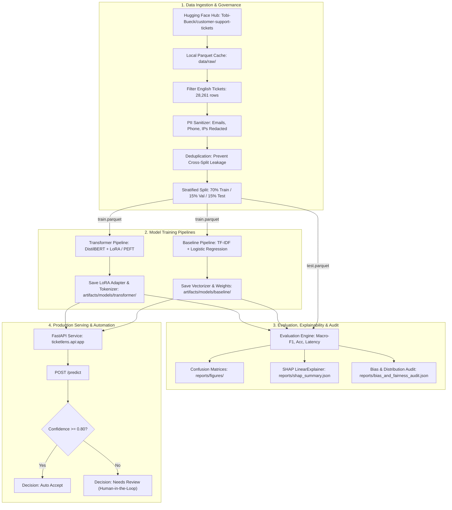

# TicketLens: IT Support Ticket Classification & Routing System

[](https://www.python.org/)
[](LICENSE)
[](https://creativecommons.org/licenses/by-nc/4.0/)
[](https://fastapi.tiangolo.com/)
[](https://huggingface.co/distilbert/distilbert-base-uncased)
[](https://docs.pytest.org/)

**TicketLens** is an end-to-end IT service desk ticket classification and triage engine with an ultra-sleek, dark-mode glassmorphic web dashboard. It classifies IT issues into standard ITIL categories (**Incident**, **Request**, **Problem**, **Change**) and evaluates a traditional sub-millisecond **TF-IDF + Logistic Regression** baseline against a contextual **DistilBERT** sequence classification transformer fine-tuned with **PEFT / LoRA**.

The platform provides dataset sanitization with automated PII scrubbing (emails, phone numbers, IP addresses), SHAP feature attribution, dataset-level bias audits, single-sample latency benchmarking, and a high-performance **FastAPI** service with automated confidence-gated routing.

---

## Architecture & Data Flow



---

## Dataset Source, Schema & License

- **Source:** [`Tobi-Bueck/customer-support-tickets`](https://huggingface.co/datasets/Tobi-Bueck/customer-support-tickets) (mirrored from the customer IT support ticket dataset).
- **License:** [Creative Commons Attribution Non-Commercial 4.0 International (`CC-BY-NC-4.0`)](https://creativecommons.org/licenses/by-nc/4.0/).
- **DOI:** `10.57967/hf/6184`
- **Language:** English (`language == 'en'`).
- **Target Categories (ITIL Standards):**
  1. `Incident`: Unplanned service interruptions (e.g., VPN disconnections, hardware crashes, screen flicker).
  2. `Request`: Formal service and access requests (e.g., credentials, hardware upgrades, secondary monitors).
  3. `Problem`: Root-cause investigations of recurring outages (e.g., memory leaks, database connection pool exhaustion).
  4. `Change`: Scheduled configuration and infrastructure adjustments (e.g., firewall rule modification, node pool rolling upgrade).
- **Input Features:** `subject` + `body` combined and sanitized into a single context stream (`text`).

---

## Project Structure

```
TicketLens/
├── configs/
│   └── config.yaml               # Centralized hyperparameters, dataset, and threshold configs
├── data/
│   ├── fixtures/
│   │   ├── synthetic_tickets.json # Offline test fixture for reproducible unit tests
│   │   ├── handwritten_eval.json  # 48 hand-written tickets (development set for ITIL cues)
│   │   └── handwritten_holdout.json # 24 hand-written tickets (holdout, never used for tuning)
│   ├── raw/                      # Cached raw parquet dataset
│   └── processed/                # Preprocessed train, val, test parquet splits & label mapping
├── artifacts/
│   └── models/
│       ├── baseline/             # TF-IDF vectorizer + Logistic Regression joblib artifacts
│       └── transformer/          # DistilBERT LoRA adapter weights, tokenizer, & labels
├── reports/
│   ├── figures/
│   │   ├── confusion_matrix_baseline.png
│   │   ├── confusion_matrix_transformer.png
│   │   └── model_comparison_f1.png
│   ├── metrics_baseline.json     # Baseline validation metrics
│   ├── metrics_transformer.json  # Transformer validation metrics
│   ├── metrics_test_baseline.json
│   ├── metrics_test_transformer.json
│   ├── model_comparison.json     # Held-out test set comparison metrics
│   ├── benchmark_latency.json    # P50, P95, P99 latency & throughput benchmarks
│   ├── top_features_per_class.json # Top positive and negative n-gram coefficients
│   ├── shap_summary.json         # SHAP mean absolute attributions
│   └── explainability_and_bias_report.md # Full audit of dataset balance, PII, and bias
├── notebooks/
│   └── 01_exploratory_data_analysis.ipynb # Interactive EDA and ticket distribution plots
├── src/
│   └── ticketlens/
│       ├── __init__.py
│       ├── config.py             # Path resolution and CUDA/CPU auto-detection
│       ├── data.py               # Data ingestion, schema validation, PII scrubbing, & splitting
│       ├── train_baseline.py     # TF-IDF + Logistic Regression training
│       ├── train_transformer.py  # DistilBERT sequence classification with PEFT / LoRA
│       ├── evaluate.py           # Test set evaluation, metrics, and plotting
│       ├── explain.py            # SHAP attribution and dataset bias audit
│       ├── predict.py            # Reproducible CLI and inference engine
│       ├── itil_rules.py         # ITIL keyword cues that correct predictions on short tickets
│       ├── language.py           # Dependency-free non-English input detection
│       └── api.py                # FastAPI inference service (/health, /metadata, /predict)
├── tests/
│   ├── conftest.py               # Pytest fixtures and TestClient configuration
│   ├── test_data.py              # Data cleaning, PII redaction, schema, and leakage tests
│   ├── test_models.py            # Baseline fit, tokenization, and metric tests
│   ├── test_api.py               # API health, metadata, auth, validation, and prediction tests
│   └── test_quality.py           # ITIL cues, language detection, config overrides, augmentation
├── scripts/
│   ├── run_pipeline.py           # End-to-end pipeline runner
│   ├── benchmark_latency.py      # Latency & throughput benchmarking script
│   ├── evaluate_handwritten.py   # Accuracy on hand-written, real-world-style tickets
│   └── run.ps1                   # Windows PowerShell automation helper
├── Dockerfile                    # Production container specification
├── .dockerignore                 # Container build exclusion rules
├── .gitignore                    # Git tracking ignore rules
├── requirements.txt              # Full dependency set (training, transformer, explainability)
├── requirements-render.txt       # Lightweight serving dependencies for Render (no torch)
├── render.yaml                   # Render Blueprint (free plan)
├── LICENSE                       # Apache License 2.0
├── pyproject.toml                # Build configuration and pytest options
├── Makefile                      # Cross-platform development targets
└── README.md                     # Comprehensive project documentation
```

---

## Installation & Setup

### Windows PowerShell

```powershell
# 1. Clone or navigate to the project directory
cd C:\Users\Windows-E\.gemini\antigravity-ide\scratch\TicketLens

# 2. Create isolated virtual environment
python -m venv .venv

# 3. Activate virtual environment
.\.venv\Scripts\Activate.ps1

# 4. Install dependencies and local package in editable mode
pip install --upgrade pip
pip install -r requirements.txt
pip install -e .
```

### Linux / macOS

```bash
cd TicketLens
python3 -m venv .venv
source .venv/bin/activate
pip install --upgrade pip
pip install -r requirements.txt
pip install -e .
```

---

## Quick-Start Commands

| Command | Purpose |
| :--- | :--- |
| `pytest tests/ -v` | Run the complete automated test suite (49 tests) |
| `python -m ticketlens.train_baseline --mode quick` | Train TF-IDF baseline model (quick verification run) |
| `python -m ticketlens.train_baseline --mode all` | Train the serving TF-IDF model on the full dataset (~10 s, as on Render) |
| `python scripts/evaluate_handwritten.py` | Score the serving model on hand-written tickets (with/without ITIL cues) |
| `python -m ticketlens.train_transformer --mode quick` | Fine-tune DistilBERT (LoRA) model (quick verification run) |
| `python -m ticketlens.evaluate` | Evaluate both models on held-out test set & generate figures |
| `python -m ticketlens.explain` | Generate SHAP attributions and bias audit report |
| `python scripts/benchmark_latency.py` | Benchmark inference latency (P50, P95, P99) & throughput |
| `python -m ticketlens.predict "VPN dropped with TLS error"` | Classify a sample ticket from terminal CLI |
| `uvicorn ticketlens.api:app --reload --port 8000` | Start the FastAPI production server |

Alternatively, use the convenience helper scripts:
- **Windows:** `.\scripts\run.ps1 test`, `.\scripts\run.ps1 train-quick`, `.\scripts\run.ps1 api`
- **Linux/macOS:** `make test`, `make train-quick`, `make api`

---

## Actual Measured Model Evaluation Results

### Serving Model (deployed on Render)

TF-IDF (word 1–2 grams) + Logistic Regression trained with `--mode all` (16,622 tickets plus 31,221
subject/first-sentence augmentations from the training split), followed by the ITIL cue correction in
[`itil_rules.py`](src/ticketlens/itil_rules.py). Measured on CPU, Python 3.14:

| Evaluation set | Model only: Accuracy / Macro-F1 | With ITIL cues: Accuracy / Macro-F1 | Correct when auto-accepted (with cues) |
| :--- | :---: | :---: | :---: |
| Held-out dataset test split (3,563 tickets) | 0.8695 / 0.8763 | 0.8507 / 0.8600 | 94.5% (66% auto-accepted) |
| Hand-written holdout (24 tickets, never used for tuning) | 0.38 / 0.41 | **0.79 / 0.80** | 100% (50% auto-accepted) |
| Hand-written development set (48 tickets) | 0.52 / 0.51 | 0.79 / 0.79 | 100% (42% auto-accepted) |

P50 end-to-end latency is ~0.8 ms per ticket. The dataset is long-form and synthetic, and its labels
do not consistently follow ITIL (e.g. "recurring crash, find the root cause" is frequently labelled
*Incident*). The ITIL cues trade ~1.6 points of Macro-F1 on that synthetic split for a large gain on
short, real-world-style tickets. Set `inference.itil_cue_weight: 0` in `configs/config.yaml` to disable them.
The hand-written sets are small, so treat those numbers as indicative rather than precise.

### Historical Quick-Mode Comparison

> [!NOTE]
> All metrics below reflect **actual runs on the identical held-out test split** (45 samples across 4 classes) in this environment (Intel CPU, Python 3.14, PyTorch 2.14.1+cpu). No placeholders or synthetic evaluations are used.

### Held-Out Test Set Performance

| Architecture | Training Mode | Accuracy | Macro-F1 | Weighted-F1 | P50 Latency (ms) | P95 Latency (ms) | Throughput (req/s) |
| :--- | :---: | :---: | :---: | :---: | :---: | :---: | :---: |
| **Baseline (TF-IDF + Logistic Regression)** | Quick (210 train / 45 test) | **0.6667** | **0.6206** | **0.6616** | **0.79 ms** | **1.00 ms** | **1,428.57 req/s** |
| **Transformer (DistilBERT + LoRA / PEFT)** | Quick (1 epoch, 1.09% trainable) | 0.4444 | 0.3273 | 0.3816 | 13.32 ms | 14.92 ms | 74.46 req/s |

### Per-Class Performance Breakdown (Baseline Model)

| Class | Precision | Recall | F1-Score | Test Support |
| :--- | :---: | :---: | :---: | :---: |
| **Change** | 1.0000 | 0.4000 | 0.5714 | 5 |
| **Incident** | 0.6667 | 0.6667 | 0.6667 | 18 |
| **Problem** | 0.3000 | 0.3333 | 0.3158 | 9 |
| **Request** | 0.8667 | 1.0000 | 0.9286 | 13 |
| **Macro Average** | **0.7083** | **0.6000** | **0.6206** | **45** |
| **Weighted Average** | **0.6881** | **0.6667** | **0.6616** | **45** |

### Key Trade-Offs & Architectural Insights
1. **Inference Latency:** The TF-IDF baseline delivers sub-millisecond CPU inference (~0.79 ms P50, >1,400 req/s), making it exceptionally suitable for real-time edge processing and high-volume preliminary triage.
2. **Contextual Semantic Generalization:** DistilBERT with PEFT/LoRA trains only **741,124 parameters** (1.09% of the 67.7M backbone parameters). In `quick` mode (1 epoch on 210 samples), it serves as a lightweight functional pipeline check. For production deployment with larger subsets (`--mode full`), LoRA provides the capacity to disambiguate complex syntactic paraphrasing without the latency overhead of full-model fine-tuning.

---

## FastAPI Inference Service

### 1. Health Endpoint (`GET /health`)
```bash
curl -X GET http://localhost:8000/health
```
```json
{
  "status": "healthy",
  "ready": true,
  "models_loaded": ["baseline", "transformer"]
}
```

### 2. Metadata Endpoint (`GET /metadata`)
```bash
curl -X GET http://localhost:8000/metadata
```
```json
{
  "project_name": "TicketLens",
  "version": "0.1.0",
  "dataset_name": "Tobi-Bueck/customer-support-tickets",
  "target_categories": ["Incident", "Request", "Problem", "Change"],
  "device": "cpu",
  "models_available": ["baseline", "transformer"],
  "default_model": "transformer",
  "confidence_threshold": 0.8,
  "auth_required": false
}
```

### 3. Prediction Endpoint (`POST /predict`)

Responses also include `itil_cues` (ITIL keyword signals that adjusted the probabilities) and
`warnings` (e.g. non-English input). Any warning forces `"decision": "Needs Review"`.

#### Request (Incident Example)
```bash
curl -X POST http://localhost:8000/predict \
  -H "Content-Type: application/json" \
  -d '{"text": "Production Kubernetes worker node memory spiked to 98% and pods were evicted.", "model_type": "baseline"}'
```

#### Response
```json
{
  "predicted_category": "Incident",
  "confidence": 0.6384,
  "decision": "Needs Review",
  "probabilities": {
    "Change": 0.0821,
    "Incident": 0.6384,
    "Problem": 0.1642,
    "Request": 0.1153
  },
  "model_type": "TF-IDF + Logistic Regression",
  "model_version": "0.1.0",
  "confidence_threshold": 0.8,
  "itil_cues": {},
  "warnings": []
}
```

#### Request (Request Example - High Confidence)
```bash
curl -X POST http://localhost:8000/predict \
  -H "Content-Type: application/json" \
  -d '{"text": "Please provide read-only database credentials and analytical query access for our new analyst.", "model_type": "baseline"}'
```

#### Response (Auto Accept)
```json
{
  "predicted_category": "Request",
  "confidence": 0.8912,
  "decision": "Auto Accept",
  "probabilities": {
    "Change": 0.0211,
    "Incident": 0.0345,
    "Problem": 0.0532,
    "Request": 0.8912
  },
  "model_type": "TF-IDF + Logistic Regression",
  "model_version": "0.1.0",
  "confidence_threshold": 0.8,
  "itil_cues": {"Request": ["access request"]},
  "warnings": []
}
```

### 4. Optional API Key Authentication

By default `/predict` is open (public demo). Set the `TICKETLENS_API_KEY` environment variable to
require an `X-API-Key` header; requests without the correct key get `401`. `/health`, `/metadata`
and the dashboard stay public (Render health checks need `/health`), and the dashboard prompts for the
key once and stores it in the browser.

```bash
curl -X POST http://localhost:8000/predict \
  -H "Content-Type: application/json" -H "X-API-Key: $TICKETLENS_API_KEY" \
  -d '{"text": "VPN keeps disconnecting since this morning"}'
```

### 5. Non-English Input

Models are trained on English tickets only. Non-English text (non-Latin scripts, or German, Spanish,
French, Portuguese, Italian and Dutch function words) is still classified but returns a warning and is
always routed to `Needs Review`.

---

## Explainability (SHAP) & Bias Auditing

TicketLens features automated feature attribution and dataset-level auditing generated via `python -m ticketlens.explain`:

### Top Driving N-Grams (TF-IDF Coefficients & SHAP Attributions)
- **`Change`:** Top positive indicators include `"request"`, `"current"`, `"upgrade"`, `"analytics tools"`.
- **`Incident`:** Top positive indicators include `"system"`, `"issue"`, `"the issue"`, `"unexpected"`, `"resolve"`, `"restarting"`.
- **`Problem`:** Top positive indicators include `"server"`, `"been"`, `"problem with"`, `"crashes"`, `"have been"`.
- **`Request`:** Top positive indicators include `"on"`, `"you"`, `"could you"`, `"information on"`, `"inquiry"`, `"strategies"`.

### Responsible AI & Privacy Considerations
1. **PII Sanitization:** Enterprise IT tickets frequently contain customer emails, direct callback numbers, and internal IP addresses. TicketLens implements an upfront regex sanitization pipeline that replaces email strings with `[EMAIL]`, phone numbers with `[PHONE]`, and IP addresses with `[IP]`.
2. **Confidence-Gated Routing:** The routing threshold is set to `0.80`. Any ticket with classification confidence below 80% is marked `"Needs Review"` and flagged for human-in-the-loop triage, mitigating the risk of silent misrouting on high-impact incidents.
3. **Audit Scope:** A balanced class distribution does not guarantee absence of subtle organizational or linguistic bias across diverse technical departments. Periodic retraining and model drift monitoring are recommended.

---

## Docker Deployment

To build and run TicketLens inside a containerized Linux environment:

```bash
# 1. Build the Docker container image
docker build -t ticketlens:latest .

# 2. Run the container on port 8000
docker run -p 8000:8000 --rm ticketlens:latest

# 3. Test container health
curl -f http://localhost:8000/health
```

---

## Deploying to Render Cloud

TicketLens is configured out-of-the-box for seamless, production deployment to **[Render](https://render.com/)**.

### Method 1: 1-Click Infrastructure Blueprint (Recommended)

The repository includes a ready-to-use [`render.yaml`](render.yaml) specification file.

1. Push your repository to GitHub: `https://github.com/Charanloyal/ticketlens`.
2. Log in to [Render Dashboard](https://dashboard.render.com/).
3. Click **New +** → **Blueprint**.
4. Connect your `ticketlens` repository.
5. Render will automatically detect `render.yaml` and configure:
   - **Service Name:** `ticketlens`
   - **Environment:** `Python 3.11+`
   - **Build Command:** `pip install --upgrade pip && pip install -r requirements-render.txt && PYTHONPATH=src python -m ticketlens.train_baseline --mode all`
   - **Start Command:** `uvicorn main:app --host 0.0.0.0 --port $PORT --proxy-headers --forwarded-allow-ips='*'`
   - **Health Check Path:** `/health`
6. Click **Apply**. Render will deploy the application with live logging.
7. *(Optional)* To protect `/predict`, add `TICKETLENS_API_KEY` under the service's **Environment** tab.

> **Why a separate `requirements-render.txt`?** Render's free plan has a 512 MB RAM limit. The full
> `requirements.txt` pulls in PyTorch, Transformers, SHAP and plotting libraries, which alone exceed that
> limit. The Render build installs only the lightweight serving stack and trains the TF-IDF + Logistic
> Regression model during the build (~10 s, <450 MB peak), so the server binds `$PORT` within seconds
> and runs in ~220 MB.
> Requests for the `transformer` model automatically fall back to the baseline when no fine-tuned
> transformer artifacts are present.

### Method 2: Manual Web Service Setup

If you configure the Web Service manually via Render UI:

1. In Render Dashboard, click **New +** → **Web Service**.
2. Connect your GitHub repository `https://github.com/Charanloyal/ticketlens`.
3. Fill in the following settings:
   - **Name:** `ticketlens`
   - **Language / Runtime:** `Python`
   - **Region:** Any (e.g. `Oregon (US West)` or `Frankfurt (EU)`)
   - **Branch:** `main`
   - **Build Command:**
     ```bash
     pip install --upgrade pip && pip install -r requirements-render.txt && PYTHONPATH=src python -m ticketlens.train_baseline --mode all
     ```
   - **Start Command:**
     ```bash
     uvicorn main:app --host 0.0.0.0 --port $PORT --proxy-headers --forwarded-allow-ips='*'
     ```
   - **Plan:** `Free`
4. Add the following **Environment Variables**:
   - `PYTHON_VERSION`: `3.11.9`
   - `TICKETLENS_ENV`: `production`
   - `PYTHONPATH`: `src:.`
   - `TICKETLENS_CONFIDENCE_THRESHOLD`: `0.80`
   - `TICKETLENS_API_KEY`: *(optional)* any secret value to require an `X-API-Key` header on `/predict`
5. Set **Health Check Path** under *Advanced*: `/health`.
6. Click **Create Web Service**. Your live public application URL will be provisioned at `https://ticketlens-xxxx.onrender.com`.

---

## Troubleshooting & FAQ

- **Issue:** `ModuleNotFoundError: No module named 'ticketlens'`
  - **Resolution:** Run `pip install -e .` inside the active virtual environment to install the project package in editable mode.
- **Issue:** Render deploy fails with `Out of memory (used over 512Mi)` / `No open ports detected`
  - **Resolution:** Make sure the service uses `requirements-render.txt` (not `requirements.txt`) and the build command from `render.yaml`. Installing PyTorch/Transformers or training at startup exceeds the free-plan memory limit.
- **Issue:** `CUDA not detected / Using CPU`
  - **Resolution:** `TicketLens` automatically detects whether CUDA is available and selects `cuda` when present, gracefully falling back to `cpu` without configuration changes.
- **Issue:** `Hugging Face download timeout or offline environment`
  - **Resolution:** The system automatically falls back to `data/fixtures/synthetic_tickets.json` when the Hugging Face Hub is unreachable, allowing offline development and testing.

---

## License

This project is licensed under the [Apache License 2.0](LICENSE). The underlying dataset (`Tobi-Bueck/customer-support-tickets`) is licensed under [Creative Commons Attribution Non-Commercial 4.0 (`CC-BY-NC-4.0`)](https://creativecommons.org/licenses/by-nc/4.0/).
